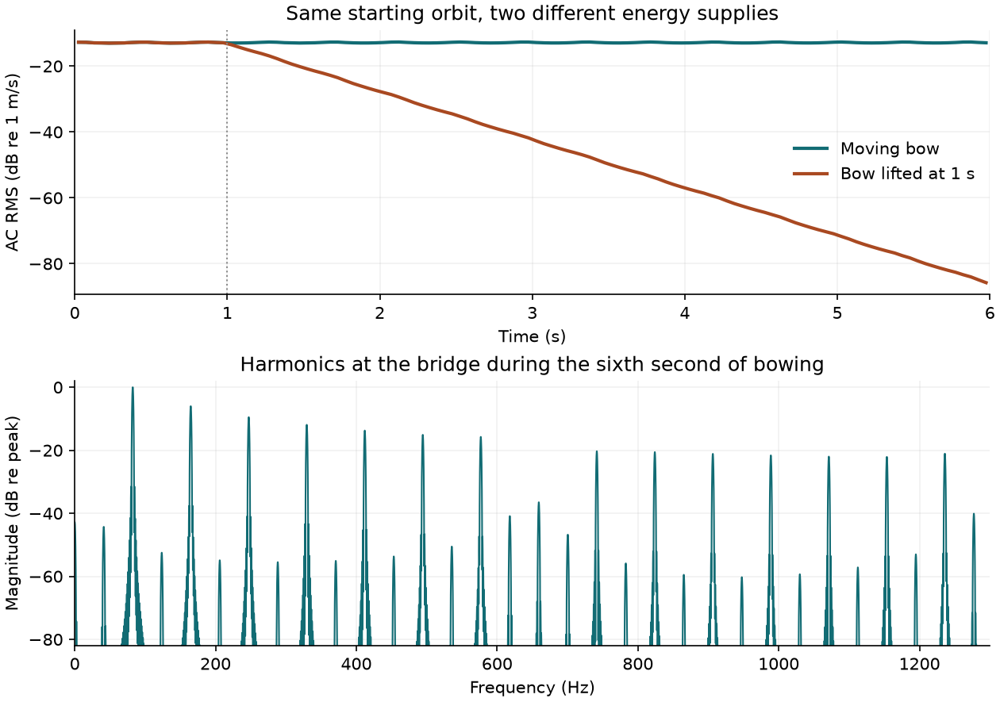

# Validation, latency and real-time budget

Use the [equations M1–M7](../architecture/BOWED_STRING_MATHEMATICS.md) as the oracle for a single voice and [A1–A4](../architecture/ELECTROBOW_TARGET_ARCHITECTURE.md) for control behavior. Numbers marked **measured** below are isolated research checks or explicitly attributed baseline measurements. Numbers in the acceptance matrix are proposed gates for future Rust and VST3 implementations.

## Measured during this investigation

**Baseline.** At aa1be375, 59 Rust unit plus 3 integration tests passed. The existing repository reports 0.216% of one M2 Pro core at 48 kHz stereo, 64 frames for the old timbral processor, median of seven one-second batches. That CPU number is historical. There is no new Rust or JUCE performance measurement. [Original measurement conditions](../timbral-instrument.md)

**Independent numerical experiment.** An offline scalar double-precision calculation used read-before-write rings, M2 linear interpolation, M3 table/branch solve and M4 histories. It sampled the bridge tap as float, with no guitar input, body, output DC blocker, automation, limiter or noise. The histories were eagerly evaluated for negative integer times (the oracle for the proposed lazy implementation). At 32, 48 and 192 kHz, f in {65.41,82.41,196,440,880,1318.51}, V=.10 m/s, R in {1.2,1.8,2.4}, all 54 seeded cases had their largest non-DC spectral peak within 6.5 cents of the requested f. Measurement used the last .5 s of a 1.2 s render, mean subtraction, Hann window, 8× zero padding and strongest local peak. The .25 Hz FFT grid is coarse at 65 Hz; its reported +2.4 cents includes measurement quantization. With zero initial histories, f=82.41 Hz, fs=48 kHz, V=.10 and R=1.0, the strongest peak was near twice the requested f. Strongest-peak identification alone does not prove the contact regime; V04 additionally measures slip events.

| Six-second render at 48 kHz, R=1.8, V=.10 m/s | Bow driven throughout, AC RMS in final second (m/s) | Contact lifted at 1 s, same final window (m/s) | Driven strongest peak (Hz) |
|---|---:|---:|---:|
| 65.41 Hz | .228423 | .000635 | 65.375 |
| 82.41 Hz | .228131 | .000144 | 82.375 |
| 440 Hz | .222149 | <.000001 | 440.000 |
| 1318.51 Hz | .203098 | <.000001 | 1315.125 |

At 196 Hz, fs=48 kHz, V=.10 and R=1.8, the sixth second contained 196 positive-slip onsets and 6468 slip samples (13.475% of the interval). At 440 Hz with V=.10, changing R from 1.2 to 1.8 to 2.4 gave AC RMS .2190, .2221, .2246 m/s. The fraction of spectral energy in 1500–6000 Hz increased from .0999 to .1137 to .1222 (one-second Hann). At R=1.8, changing V from .06 to .16 gave .1339 to .3547 m/s. These directional checks apply to that nominated operating point. The figure shows the low E fixture, 50 ms mean-free RMS bins, and the last driven second's Hann spectrum with 8× zero padding. The two curves begin with identical stored energy.



An additional model-only test at fs=48 kHz, V=.10, R=1.8 prescribed 196 Hz for 1 s, a linear-in-cents +200 cent bend over .2 s, then steady pitch with ±35 cent, 5 Hz vibrato added from 2 s. Direct samplewise P updates gave 1.77 cents RMS error during the bend and 1.49 cents during 2.3–5.7 s. Offline measurement isolated the fundamental with a forward/backward third-order Butterworth bandpass (150–290 Hz), unwrapped Hilbert phase, and used a symmetric ±6 ms phase derivative. The research calculation omits the guitar tracker and hop ramp. Compare the full effect separately.

**Analysis check on DI recordings.** Independently recomputing A2's differences directly on 44.1 kHz files in `ThirdParty/q/test/audio_files/`, with A1 HP/FIR, using every fifth millisecond and windows with analysis RMS-equivalent standard deviation >.004 FS, gave the counts below. The denominator is the number of eligible windows, numerator is the number passing the .15 first-minimum test and Hz range. Values describe the estimator. They exclude acquisition, hysteresis and the complete voice controller.

| Recorded input | Accepted/eligible windows | Median accepted Hz |
|---|---:|---:|
| 1a-Low-E.wav | 3103/3117 | 82.10 |
| 4a-G.wav | 905/917 | 196.05 |
| 6a-High-E.wav | 595/603 | 329.00 |
| 6c-High-E-24th.wav | 409/412 | 1312.16 |
| Bend-Slide G.wav | 1303/1327 | 328.81 |
| GStaccato.wav | 1351/1567 | 292.16 |

A high acceptance rate alone cannot distinguish a correct note from an octave error, particularly on bends and staccato. Use labeled synthetic trajectories for tolerances and recorded gestures for failure discovery. The new plugin was neither built nor heard for this research.

## Budget and latency accounting

| Quantity | Engineering budget or calculation |
|---|---|
| Host rates, layouts, blocks | Synthesis 32–192 kHz, mono/stereo. Qualification 32/44.1/48/88.2/96/176.4/192 kHz, plus 4/8/384 kHz timbral fallback. Blocks 0,1,16,17,32,64,127,256,1024,4097, and >8192 with prepared hint 64. Include offline random partitions. Compute elapsed time in stream samples. |
| Observation versus hop | Fₐ=fs/floor(fs/8000), H≈.005Fₐ. W+K≈2Fₐ/65+1 ≈31 ms history. The anti-alias FIR center delay adds 1.6–2 ms, hop alignment adds 0–5 ms and a second agreeing estimate ~5 ms. Pick detection itself rounds to a hop and has level rise time. Allow about 40–55 ms before wet launch on a clean low string. Amplitude ramps add 8–500 ms to full wet. An ambiguous pick may remain direct throughout. Ongoing pitch uses past evidence with roughly 10–18 ms center-age plus hop and slew. |
| Fixed vs perceptual delay | The direct, neutral and bypass paths have zero intentional transport delay. Report 0 host samples of compensable latency. No future input is read. Measure onset-to-first-direct, onset-to-confirmed-pitch, onset-to-10% wet amplitude, onset-to-90% wet and trajectory lag separately. Host/device buffering adds at least the applicable I/O scheduling delays (64/48000=1.33 ms per block interval). Host compensation cannot make a new live pluck observable earlier. Supported-rate tail report 1.25 s. |
| Analysis arithmetic | At fs=48 kHz, D=6, Fₐ=8000, W=124, K=125, H=40. About 1.0 million two-pair lag updates/s/lane; across supported rates <1.56 million/lane. Two squared differences, additions and indexed reads per active lag plus O(K+W) per hop for normalization/search/rebase. FIR cost (32D+1) multiplies per decimated sample, near 32fs/s/lane. Worst coincident FIR, hop and launch in one callback is the timing case. |
| Waveguide arithmetic | Three 2-tap linear reads (two feedback, one output), two writes, symmetric 3-tap return FIR, DC block, one static test or at most nine affine segment checks and one interpolation. No nonlinear Newton iteration, exponentials for μ, or searches of unbounded length per sample. The seed needs extra arithmetic for at most its history horizon, evaluated on demand. Three new one-poles and eight existing biquads per active wet lane; reuse prepared coefficients. Output bounds apply pre/post limiter independently. |
| Memory | Each ring ceil(fs/65)+4 f64 values, ≤2958 at 192 kHz, or 4096 with power-of-two storage. Four such rings ≤128 KiB stereo. Band scratch currently 8×capacity×4 bytes. New raw/low/high scratch 6×capacity×4 bytes, ≤192 KiB at capacity 8192. Existing JUCE wet scratch ≤64 KiB. FIR max 769 coefficients shared, two histories. Decimated history ≤W+K+1 per lane, two lag arrays, counters, voice and filter states. Budget ≤64 KiB for analysis/control beyond scratch/rings and **≤0.8 MiB** per prepared stereo stream for all listed DSP and host audio buffers, excluding code/GUI/host buffers. Measure allocated capacities after prepare. |
| Time targets, estimates until benchmarked | Release on M2 Pro single performance core or documented reference equivalent, stereo both tracking. Mean callback DSP <10% of one core at 48 kHz/64 and <20% at 192 kHz/64. p99.9 <50% of block deadline on warm dedicated runs for B≥16. At 48 kHz/64 these budgets are 133 µs mean, 667 µs p99.9. Log max and every overrun; require zero DSP-caused deadline misses on the test machine. At B=1 characterize worst coincident work separately; the hard deadline at 192 kHz is only 5.21 µs. A failure requires distributing bounded FIR/analysis work or optimizing and remeasuring, not concealing it in block averages. |
| Real-time and numeric contract | Fallible sizes/reservation at prepare. No heap operations in callback/reset, bounded loops, no locks, I/O, timers, workers, panics or debug formatting. Use relaxed atomics only for independent UI telemetry. Sanitize before analysis, finite checks before storing returned waves, test denormals with JUCE guard and standalone Rust. Flush subnormal inactive states. No data races across instance handles, UI and audio. Instrument f64 internally, f32 planar audio externally. |

## Measurement conventions

Default fs=48 kHz, mono unless specified, 100 ms silent pre-roll and at least 1.3 s post-roll for effect tests. Inactive production signal has exactly zero wet component. For isolated tests use V=.10, R=1.8, β=.127, bypass body/output stages, capture bridge p, wave histories, branch and F. For end-to-end fixtures start with Attack=20 ms, Character=1, Noise=0, Saturation=.5, Movement=0, Out=.5. Distinguish direct and wet components with test-only probes. Calibrate FS as linear sample amplitude, dBFS RMS=20log₁₀(rms), ratios in dB use a 1e−12 floor. Logs must include seed, rate, controls, block sequence, window times, compiler/build mode, machine and revision.

Let θ[n+1]=θ[n]+2π f[n]/fs. Use deterministic pluck x[n]=A(1−exp(−t/.001))exp(−t/τ)·Σ sin(kθ[n]+φₖ)/k for k=1…8 below .45fs, with φₖ=.13k² and scale to named peak A after rendering. Default A=.35 FS, τ=.28 s. Use direct-frequency sine/harmonic fixtures where specified. For a ground-truth bend define f=f_start·2^(cents(t)/1200). Never evaluate sin(2π f(t)t) as that changes the instantaneous frequency. Use deterministic test noise from a documented xorshift32 sequence (13,17,5), seed 1, scaled to the requested RMS. Recordings are test inputs in this checkout. Do not ship them as part of the plugin.

For static model pitch, compute an independent FFT of a ≥.5 s mean-free Hann segment, 8× padding. Use strongest local peak with quadratic interpolation of log magnitudes, and check partials relative to *target* f over a ±15 cent/at least two native-bin tolerance. Reject octave-only tones even if a correlation is high at twice the true period. For harmonic power fraction η, integrate power in ±max(2/T, .001·kf) Hz bands around k·f_measured, k≥1 below Nyquist, relative to all non-DC power; merge overlapping bins, use stationary 1 s windows T. Also report the number of nontrivial partials. For dynamic measurements use analytic phase of an independently isolated first harmonic, or fit complex sinusoids in sliding windows with known reference phase. Report fixed time lag maximizing correlation in 0–45 ms and residual cents error **after** alignment, plus uncompensated error. Do not use the production tracker to grade itself.

## Automated cases and acceptance criteria

| ID | Input, duration and measurement | Required result |
|---|---|---|
| V01 — baseline and neutral | 2 s deterministic guitar, impulse and zeros. Test existing/supported/fallback rates, mono/stereo. Attack=Character=0, Out=.5, below limiter. Compare input/output samplewise through normal JUCE and C ABI, in-place and separate. | Error ≤2e−7 FS, no added direct delay; zero-frame call consumes no state. Restored v1–v5 parameter mappings and six automation IDs match baseline. Verify native bypass returns original finite host audio after ramp. |
| V02 — junction oracle | At one synthetic sample per case sweep d=−2…+2 m/s in .001 increments, k in {0,.03,.10,.23}, previous in {Stick,Slide±}. Add exact knot values transformed into h, h₀±1e−11 and both sweep directions. Check residual, branch selection and Fv flux identity from M6 for a=.13, b=V−a−d. | Residual <1e−10 m/s, power error <1e−10 W for these inputs, force ≤F_N μ₀+2e−10 N, Fr≥−1e−12 W. Upper root retained while feasible, lift returns j=0. Nonfinite fault returns finite output. ≤9 segment probes. |
| V03 — delay and seed | Impulse into a single f64 ring, D=1, 3.25, max−2, and integer-boundary ramps, 3 wraps each. Closed passive guide measure response phase at 65.41, 440, 1318.51 Hz. Compare M4 lazy vs prefilled negative history for 100 ms including a downward retune. | Fractional impulse weights .75/.25 at samples 3/4 for D=3.25; max tap error <1e−10 m/s, no early sample. Total passive phase delay within .003 samples of nominal P at f₀. Lazy and eager output agree to 1e−9 m/s. |
| V04 — generated pitch and stable bow | M4 launch with no continuing external audio, 3 s per note on the 54-case research grid and 44.1/96 kHz. Measure last-second pitch, η, RMS and rising slip episodes (count Slide onset after Stick). | Dominant fundamental within 12 cents, η≥.90, ≥3 harmonics above −36 dB relative to fundamental for f≤880. AC RMS>.04 m/s, last/penultimate RMS within 2 dB. Nominal 196 Hz at 48 kHz should have 0.95–1.05 slip episodes/period and mean slip duty within .05 of β. Log other regimes, reject persistent octave substitution or silent seeds. |
| V05 — remove bow work | Same initial history, f=65.41/82.41/440 Hz, release k to zero at 1 s in a 7 s pure-string render (no output envelope). Compare 0.8–1 s and 6.8–7 s AC RMS with continuously driven twin. | Passive drop ≥60 dB even at 65.41 Hz, driven twin within ±2 dB. No hidden periodic seed after negative history expires. Production musical release tested separately. |
| V06 — pressure | 3 s each at 440 Hz, fs=48 kHz, V=.10, R=1.2/1.8/2.4. Log static force limit and 1500–6000 Hz fraction of last-second bridge spectrum. | F_N ratio high/low=2 within 1e−6; high-pressure band fraction exceeds low by ≥.01 absolute. Both retain f within 12 cents, no required monotonic loudness across the entire fingerboard. |
| V07 — velocity | 3 s at 440 Hz, R=1.8, V=.06 and .16; compare final second. Also inject 2 s of k=0,V=0 into a cleared voice. | Faster bow RMS at least 1.8× slower bow (reference ~2.65×); both voiced, bounded. Cleared/lifted voice emits zero. |
| V08 — safety and controls | 10 min seeded pseudo-random notes, slew/repick, all 64 six-dial corners, deliberate input overload ±16 FS and nonfinite samples, silence; run in stereo. Inject one internal NaN at a known sample separately. Record pre/post-limiter peaks and faults. | All output finite, processed sample peak ≤.980001 FS, no nominal wave exceeds 4 m/s, zero nominal faults. Injected fault clears only affected lane after a ≤5 ms ramp, clean reacquisition on next note. Out=0 silent after trim settling. Normal .35 FS pluck at unity Out should invoke limiter <1% of frames. |
| V09 — long hold stationarity | 60 s continuous supported 196 Hz pluck-like periodic drive or inject constant supported frames directly, then 2 s silence. Compare 1 s Hz, η and AC RMS per second, and mean DC. | Isolated constant-control bridge stays within ±12 cents, RMS drift <2 dB after first second, no faults. Wet post-DC mean <.002 FS at constant gain. In full engine, silence expiry meets V14. |
| V10 — bend and true legato | 196 Hz to +200 cents/200 ms and back over 200 ms on a ≥2 s held, amplitude-stable harmonic DI; separate clean +500 cent instantaneous hammer-on without a level transient. Compare analytic phase to known continuous trajectory and state log. | Bend retains one launch, max acquired lag ≤40 ms, aligned RMS error ≤15 cents, no octave excursions or output reset. Legato jump confirmed within 75 ms with one faded replacement, no sweep through unrelated notes. |
| V11 — vibrato | 3 s, ±35 cents sine at 5 Hz around 196 and 440 Hz; analyze final 2 s on wave-only and full paths. Fit sinusoid to output cents, record modulation frequency/depth and lag. | Modulation 5±.2 Hz, depth 25–42 cents, lag ≤40 ms full, aligned RMS ≤12 cents, no reacquisition. Model-only continuous-control case has RMS error ≤6 cents. |
| V12 — tracker and acquisition | 2 s each of single sine, six-harmonic DI and pluck at f=65.41/82.41/110/196/329.63/440/880/1318.51, at peaks .03/.35 FS. Add an 8 ms noise pick and a weak-fundamental case (harmonics 1…4 weights .05,1,.6,.35) at 110 Hz. Compare dτ to direct f64 sums and Hz against truth while above keep threshold. | Max difference <1e−8 FS² for bounded normalized fixtures, clean steady median ≤12 cents, 95th ≤25 cents, octave error <1% of eligible windows. Strong clean low E wet launch ≤60 ms after 1 ms rise, excluding configured wet ramp. With pick noise allow 80 ms. No first-fret quantization. |
| V13 — quiet and noise | From reset, 10 s zeros; 10 s each independent white noise at −65 and −30 dBFS RMS, 50/60 Hz hum at −50 dBFS, isolated 2 ms pick clicks. Repeat after a supported note with post-roll. | Exact zero output from zero input/reset. From idle zero launches for specified unpitched fixtures. Direct noise may be audible. After a note, no renewed support from wet audio. A loud, periodic in-range interferer is a documented ambiguity. |
| V14 — hold vs mute | .35 FS 110 Hz pluck, τ=.16 s, run to below threshold then digital zeros through 3 s. Separately cut a strong 440 Hz tone with a 2 ms taper at .40 s. Log last support, mute evidence, E and emitted wet RMS. | Natural decay retains active contact ~750 ms from last support (±one hop absent hard silence cap), wet RMS >−48 dBFS for first .4 s of hold at full depth. E=0 after 100 ms release. Strong mute starts release within 35 ms, E=0 within 75 ms of cut. Output from silence below 1e−7 FS within reported tail; idle wet exactly zero. |
| V15 — repicks and continuity | Two .24 s spaced picks at same f, soft then loud, 3 s total; abrupt parameter changes/renewed onset during Release, new note one octave up, and one spurious octave frame. Capture voice count, timestamps, gain trajectories and late waveform. | Two launches for distinct picked events, no launch for lone octave frame. No simultaneous notes within lane. For retrigger gain step ≤1/round(.005fs)+1e−6 FS/FS per sample and new seed installed only at E=0. Compare one-sample-shifted automation outputs as baseline fixture does, max onset difference <.01 FS on .2 FS fixture. Check the derivative at transitions separately from normal stick/slip harmonics. |
| V16 — stereo and ambiguous input | 2 s sustained tone L only, duplicated L/R, then R=−L at equal level; two independent 110/196 Hz inputs; reset after first note and replay. 2 s noncommensurate simultaneous tones 196 and 277.18 Hz in one lane plus recorded D chord. | Silent lane stays exactly silent, equal lanes equal and inverted lanes sum to <1e−6 FS for symmetric drive. Independent channels retain their individual Hz. When unvoiced, shaped direct is preserved; no more than one accepted Hz/lane and no unstable bouncing (>3 confirmed switches/s on steady chord). Log false locks rather than claiming chord recognition. |
| V17 — body and noise | 3 s stationary string 82.41/196/440 Hz, no direct signal, render bridge-only and final wet at noise=0,.5,1 with movement/saturation endpoints; 3 s sine sweep 65–4000 Hz in isolated body path. | External body changes normalized RMS ≤3 dB on these notes, strongest peak remains f₀, harmonic fraction ≥.85 at factory noise. For fixed controls/LFO compare same-seed noise-on minus noise-off; residual RMS at factory ≤−28 dB relative to noise-off wet. Measure sweep for narrow peaks >6 dB relative to bridge. All detail controls have measurable effect on supported notes. Repeat at 32 kHz and 1318.51 Hz, Noise=0. Flag inharmonic/folded components if η<.85; compare to a separately rendered 96 kHz reference, low-passed and decimated for diagnosis. Linear interpolation and bridge losses soften high partials but do not strictly band-limit a nonlinear junction. |
| V18 — no heap or blocking | Extend existing thread-local allocator counter, arm only after prepare and test harness warmup. Process 60 s with at least 10 of each acquire/hold/mute/retrigger/fault, block sizes including 1 and oversized host chunks; call reset repeatedly. Also exercise 30 s of near-denormal inputs. | 0 allocations/reallocations/frees while processing/reset. Static review of reachable callbacks for locks, I/O, logging, global mutable state, fallible indexing and loops; no unbounded work. Native FFI harness includes bypass and asserts no host-buffer resize in render. Benchmark denormals vs silence, median ≤2× warmed silence. |
| V19 — streaming and ABI | 5 s input with bends/gaps, schedules identical in *sample time*, partitions [1,17,64,127,256,1024,4097] and deterministic random lengths; inject zero calls, oversized JUCE callback, invalid metadata and supported aliasing. Compare complete output and event timestamps against 64. | Same transitions at same samples, peak difference ≤1e−6 FS; exactly repeatable on reset for same partition. Rejected FFI call causes no changed history or output. Serialize control events by splitting at identical event indices, not by updating once per differently sized block. |
| V20 — sample-rate behavior | Synthesize equivalent analytic input at every qualification rate, 3 s/note. Measure f, RMS, onset/hold/release, neutral reconstruction, fallback controls and tail. Do not compare raw arrays across rates. | Nominal active pitch within V04/V12, final wet RMS spread <3 dB, control durations within one hop plus two samples. Outside synthesis range previous six-control behavior and short tail pass existing tests. Preparation failure clears host output. |
| V21 — shipped plugin and deadline | Release CTest and packaged plugin, known wet preset and saved-state recall. Time ≥60 s per size/rate with inactive, locked, changing pitch, repeated launch and two active lanes. Warm cache; time callback externally using monotonic high-resolution clock, subtract measured harness baseline or report it. Include 10 min live or host stress run. | Budgets above, no plugin-caused underrun, declared tail contains actual audio after silence, reported fixed latency=0 and first direct sample on time. VST3 reload/replay peak error ≤1e−6 FS, v1–v5 accepted, bypass ramp and GUI meter intact. Publish p50/p99/p99.9/max, overruns, hardware, OS and compiler; a median alone is insufficient. |
| V22 — bounded listening review | Use the three comparisons below after numerical gates. Save original-gain and separately level-matched randomized pairs, with controls, excerpts and reviewer decisions. | Human review resolves bow identity, expression and objectionable artifacts. Record any failed excerpt with timestamp and diagnosis; objective gates alone cannot sign off bowed timbre. |

### Small listening review

1. **Sustain in isolation.** Compare one unprocessed low E, legacy wet and new full-wet on the same DI, then a high E. Match active-note RMS within .5 dB for listening copies. Does the tail sound driven by a bow, remain pitched, and avoid hiss or a static synth buzz? Also hear the untouched levels for attack/sustain balance.
2. **Player control.** Use `Bend-Slide G.wav`, `Hammer-Pull High E.wav` and `GStaccato.wav` as one short annotated passage. Judge bend lag, repick distinction, note stops and zipper/clicks on headphone and small speaker. Include an actual live monophonic phrase on acoustic or mic'd guitar and an electric DI to cover handling/room noise and tactile latency.
3. **Identity and fallback.** Compare a bright bridge pickup and warm guitar through factory settings, followed by a staggered D chord into a single note and bypass. Check if they remain distinguishable and if ambiguous material gives way gracefully to the next identifiable note. Include inverted stereo and a spatial stereo recording. Log the actual host/plugin identity and route.

Use `cargo test --workspace --locked --offline` and the repository's normal CMake build followed by `ctest --test-dir <build> -C Release --output-on-failure`. For the binary-level fixtures run `python tools/render_guitar_comparisons.py <built.vst3> <output-dir>` with its optional Python packages. Extend that tool's silence padding to at least 1.3 s for active-note tail tests. Keep measurements in build artifacts; the [migration plan](ELECTROBOW_MIGRATION_PLAN.md) assigns each gate to a change.

## Executable reference for the low E energy check

Run this Python 3 block offline. It deliberately recomputes knot loads and eagerly evaluates the initial history to give the Rust implementation a small, independently organized oracle. Its returned statistic is standard deviation of the last second of the uncolored bridge **velocity**. Change `lift` only between the two runs. Do not put this reference loop on an audio thread.

```python
from math import exp, floor, ceil
from statistics import pstdev

def final_bridge_rms(lift):
    fs, frequency, speed, ratio, beta = 48000, 82.41, .10, 1.8, .127
    period = fs / frequency
    db, dn = beta * period - 1, (1 - beta) * period
    count = ceil(period) + 4
    q = (0, .005, .01, .02, .04, .08, .16, .32, .64, 1.28)
    mu = [.35 + .85*exp(-v/.01) + .45*exp(-v/.1) for v in q]
    k = ratio * speed / mu[0]
    loads = [v + k*m for v, m in zip(q, mu)]

    def saw(t):
        return t - floor(t) - .5

    bridge, neck = [0.] * count, [0.] * count
    for t in range(-count, 0):
        bridge[t % count] = speed/beta * saw(t/period)
        neck[t % count] = -speed/beta * saw(t/period + 1 - beta)

    def read(history, n, delay):
        lag = floor(delay)
        u = delay - lag
        return (1-u)*history[(n-lag) % count] + u*history[(n-lag-1) % count]

    x1, x2 = read(bridge, -1, db), read(bridge, -2, db)
    sliding = 1
    tail = []
    for n in range(6*fs):
        x = read(bridge, n, db)
        a = -read(neck, n, dn)
        b = -.98*(.125*x + .75*x1 + .125*x2)
        x2, x1 = x1, x
        d = speed - a - b
        h, sign = abs(d), 1 if d >= 0 else -1
        if lift and n >= fs:
            j, sliding = 0., 0
        else:
            slip = 0.
            if h > loads[0] or sliding == sign:
                if h >= loads[-1]:
                    slip = h - k*mu[-1]
                else:
                    for i in range(len(q)-2, -1, -1):
                        width = loads[i+1] - loads[i]
                        if width > 1e-12 and loads[i] <= h <= loads[i+1]:
                            slip = q[i] + (q[i+1]-q[i])*(h-loads[i])/width
                            break
            sliding = sign if slip > 1e-12 else 0
            j = d - sign*slip if sliding else d
        if n >= 5*fs:
            tail.append(read(bridge, n, beta*period/2))
        bridge[n % count], neck[n % count] = a+j, b+j
    return pstdev(tail)

assert abs(final_bridge_rms(False) - .228131) < .000002
assert abs(final_bridge_rms(True) - .000144) < .000002
```
